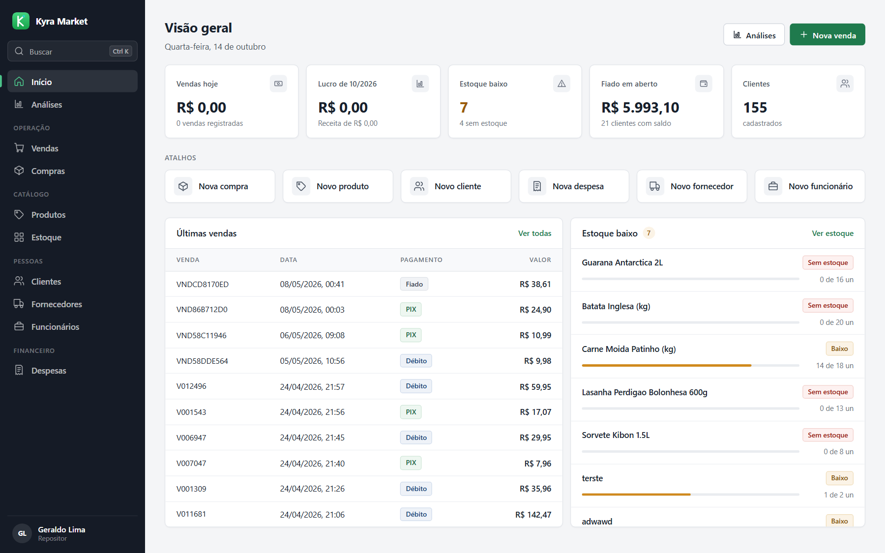
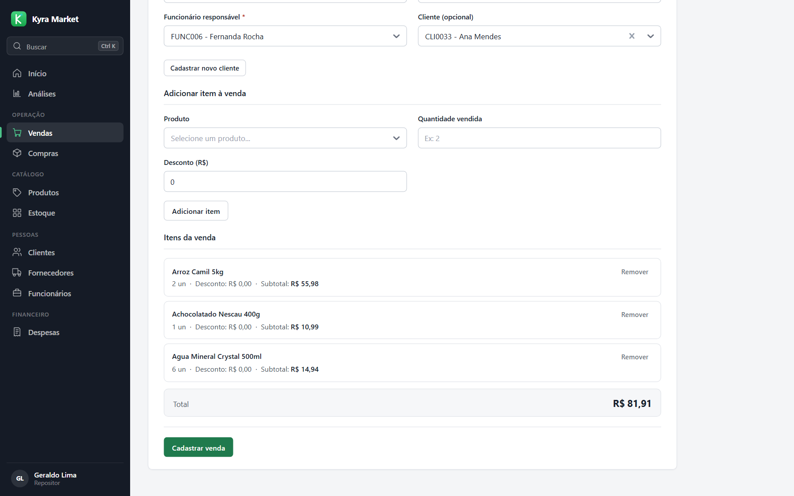
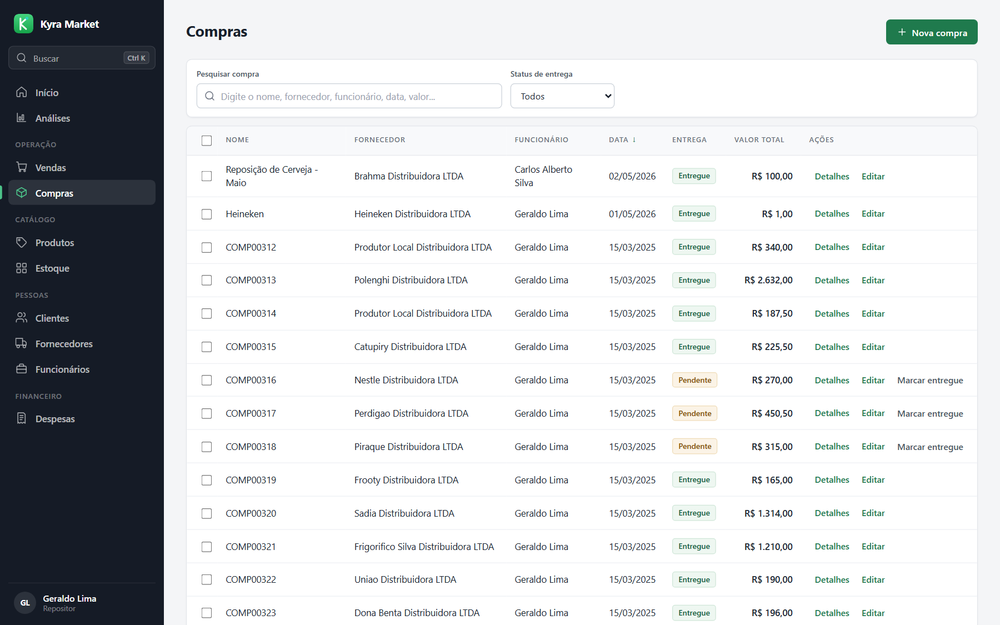
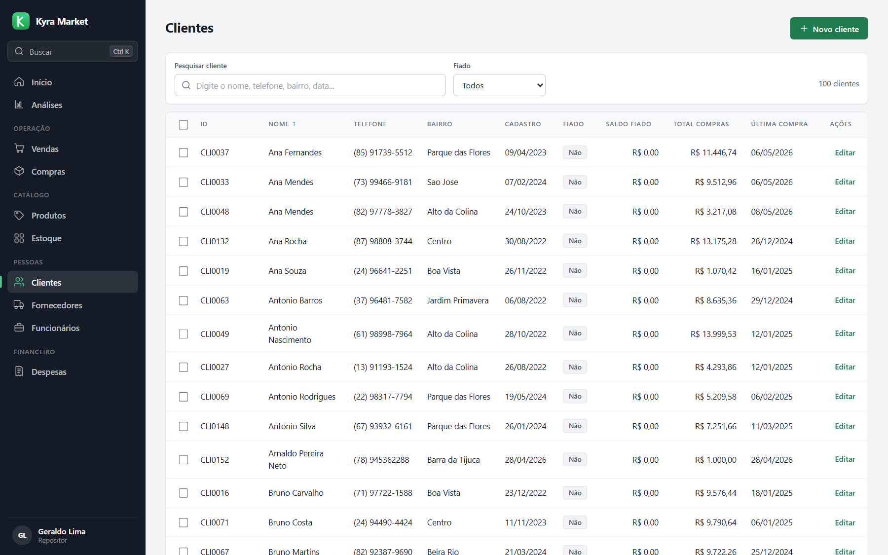
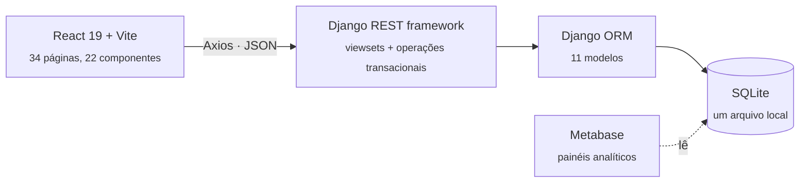

<div align="center">


# Kyra Market

**Gestão completa de um mercadinho: vendas, fiado, estoque, compras e financeiro, num sistema que roda no seu próprio computador.**


[Rodar em um comando](#rodar) &nbsp;·&nbsp; [Funcionalidades](#o-que-ele-faz) &nbsp;·&nbsp; [Como funciona por dentro](#como-funciona-por-dentro) &nbsp;·&nbsp; [Equipe](#equipe-e-histórico)

<br />



</div>

<br />

## O problema

O Geraldo toca um mercadinho e anotava tudo à mão: vendas em cadernos, fiados em folhas soltas e o estoque de cabeça. Isso gerava histórico perdido, nenhuma ideia do lucro real do mês, rupturas e excessos de estoque, fiado sem rastreio (inadimplência invisível) e compras de fornecedores desorganizadas.

O Kyra Market é a resposta: um sistema web completo que **roda localmente, sem internet e sem servidor externo**, feito para quem está no balcão, não para quem entende de TI.

> Projeto desenvolvido pela equipe **IBMEC Jr** como solução para esse desafio. Veja [quem escreveu o quê](#equipe-e-histórico).

## O que ele faz

| | |
|---|---|
| **Vendas** | Várias linhas por venda, todas as formas de pagamento do balcão (dinheiro, PIX, débito, crédito e fiado) e baixa automática no estoque a cada venda confirmada. |
| **Fiado** | O saldo de cada cliente é atualizado em tempo real, com pagamento parcial ou total direto pelo sistema e validação para ninguém pagar mais do que deve. |
| **Estoque** | Quantidade atual e mínima por produto, com alerta automático quando algo cai abaixo do mínimo e data da última entrada e saída. |
| **Compras de fornecedores** | O pedido nasce "pendente"; ao marcar como entregue, o estoque sobe sozinho. Cada compra gera a despesa correspondente, sem digitar duas vezes. |
| **Clientes e fornecedores** | Histórico de compras, total gasto, última compra e fiado em aberto; fornecedores com CNPJ, prazo de entrega, avaliação e os produtos que fornecem. |
| **Equipe e despesas** | Funcionários com cargo, turno e horas; despesas por categoria com filtro por data. Toda venda e compra fica ligada a quem a fez. |
| **Resultado do mês** | Receita, despesas, compras e **lucro líquido** calculados automaticamente. O Metabase (opcional) entrega painéis analíticos com gráficos e filtros. |
| **Cadastro sem atrito** | Pesquisa em todas as listas, campos com busca, consulta de CEP, máscaras e mensagens claras de sucesso e de erro. |

## Telas

<table>
<tr>
<td width="50%"><br /><sub><b>Nova venda</b>: dados da venda e itens, com busca de funcionário, cliente e produto.</sub></td>
<td width="50%"><br /><sub><b>Compras</b>: status de entrega, fornecedor, responsável e valor.</sub></td>
</tr>
<tr>
<td colspan="2"><br /><sub><b>Clientes</b>: busca, filtro de fiado, saldo em aberto, total comprado e data da última compra.</sub></td>
</tr>
</table>

> Os dados dos prints são de demonstração, gerados para o projeto.

## Em números

| | |
|---|---|
| **11** modelos de dados | **10** recursos REST + **4** operações dedicadas |
| **34** páginas e **22** componentes React | **10** migrations |
| **~2,7 mil** linhas de Python (sem migrations) | **~7,2 mil** linhas de JavaScript |

## Rodar

```bash
python INICIAR.py
```

O script confere os requisitos, instala o que faltar (Python e Node), sobe o backend, o front-end e o Metabase e abre o sistema no navegador em **http://localhost:5173**. `Ctrl + C` encerra tudo.

**Requisitos:** Python 3.10+, Node.js 18+ e, se quiser os painéis do Metabase, Java 11+.

<details>
<summary><b>Rodar cada parte à mão</b></summary>

```bash
# backend (Django)
pip install -r Materiais/requirements.txt
cd sistema_estoque
python manage.py runserver 8000

# front-end (React + Vite), em outro terminal
cd sistema_estoque/front-end
npm install
npm run dev
```

</details>

Os painéis do Metabase, quando ativados, ficam em **http://localhost:3000**.

## Como funciona por dentro



| Camada | Tecnologia |
|---|---|
| Front-end | React 19, Vite, React Router, Axios, React Select |
| Backend | Django 6 + Django REST framework, com `django-cors-headers` |
| Banco | SQLite, sem nada para instalar ou configurar |
| Análises | Metabase, ligado sozinho ao banco do Django na inicialização |
| Entrada única | `INICIAR.py` (Windows, macOS e Linux) |

```text
INICIAR.py                  ponto de entrada único
sistema_estoque/
  manage.py                 backend Django
  mercadinho/
    models.py               Produto, Venda, ItemVenda, Cliente, MovimentoFiado, Estoque, Fornecedor...
    views.py                API com a lógica de negócio transacional
    serializers.py          validação e serialização
  front-end/src/
    pages/                  uma página por entidade: lista, cadastro e edição
    components/             formulários, tabelas, busca, mensagens, navegação
    services/               chamadas à API
    utils/                  máscaras, formatadores, cache de requisições
  metabase/                 configuração do Metabase (opcional)
```

### Decisões técnicas que valem a pena olhar

- **Transações atômicas em vendas e compras.** Cada venda e cada entrega de compra roda dentro de `transaction.atomic()`, então o estoque nunca fica inconsistente se algo falhar no meio da operação.
- **Despesa ligada à compra.** Ao registrar ou editar uma compra, a despesa correspondente é criada ou atualizada sozinha, na categoria "Compra de mercadorias", sem lançamento duplo.
- **Alerta de estoque mínimo como endpoint.** `/api/estoque/alerta-minimo/` devolve tudo o que está abaixo do nível configurado, para o dono agir antes de faltar.
- **Fiado com saldo e histórico.** `Cliente` mantém `saldo_fiado` e `possui_fiado` a cada venda no fiado e a cada pagamento; `MovimentoFiado` guarda o histórico e o pagamento acima do saldo é recusado.
- **Metabase que se configura sozinho.** O `INICIAR.py` espera o Metabase subir, autentica pela API e corrige o caminho do SQLite, que muda de máquina para máquina.
- **Importador de planilhas legadas.** Aceita variações como "Espécie", "Credito" e "PIX" e normaliza para os valores do sistema, para migrar o histórico do Geraldo sem retrabalho.
- **Listas rápidas.** A API é paginada (a tabela de vendas chegou a ter dezenas de milhares de registros) e o front-end guarda em cache as requisições repetidas.

### API

| Rota | O que faz |
|---|---|
| `/api/produtos/` `/api/estoques/` `/api/clientes/` `/api/fornecedores/` `/api/funcionarios/` `/api/despesas/` | CRUD de cada cadastro |
| `/api/vendas/` `/api/itens-venda/` | Vendas e seus itens |
| `/api/compras/` `/api/itens-compra/` | Compras de fornecedores e seus itens |
| `POST /api/registrar-venda/` | Venda completa em uma transação (itens, estoque, fiado) |
| `POST /api/registrar-compra/` | Compra completa em uma transação, com a despesa |
| `POST /api/pagar-fiado/` | Pagamento de fiado, parcial ou total |
| `GET /api/lucro-mensal/` | Receita, despesas, compras e lucro do mês |
| `GET /api/estoque/alerta-minimo/` | Produtos abaixo do estoque mínimo |

## Equipe e histórico

O sistema nasceu como projeto da equipe **IBMEC Jr**, entre 21/04 e 08/05, e hoje é mantido por [Kauê (@KaueFSS)](https://github.com/KaueFSS) como o **Kyra Market**, da família de ferramentas [Kyra](https://github.com/KaueFSS).

Quem escreveu o código, com o número de commits:

| Pessoa | GitHub | Commits |
|---|---|---|
| Micael Dali | [@Micdali](https://github.com/Micdali) | 34 |
| Kauê | [@KaueFSS](https://github.com/KaueFSS) | 52 |
| Bernardo Brandão | [@BernardoBrandao-dev](https://github.com/BernardoBrandao-dev) | 24 |
| Rafael Correa | [@RafaelCorrea160407](https://github.com/RafaelCorrea160407) | 18 |
| João | [@joao245br1](https://github.com/joao245br1) | 9 |
